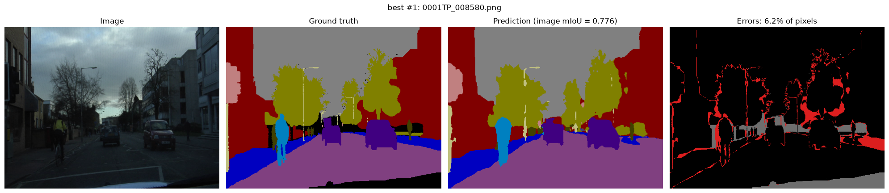
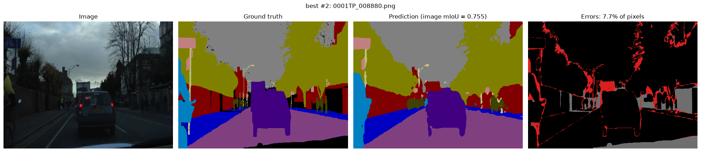
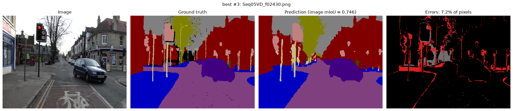
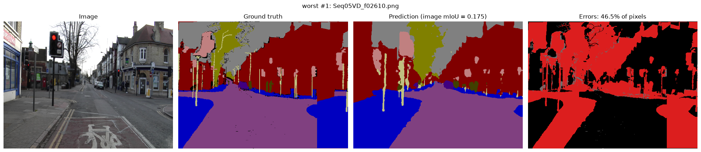
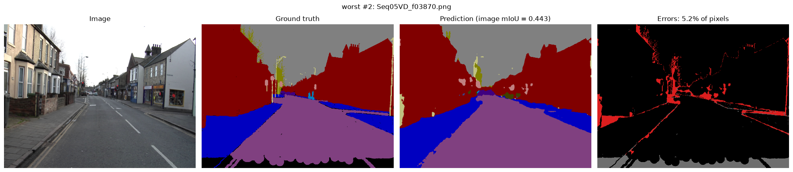
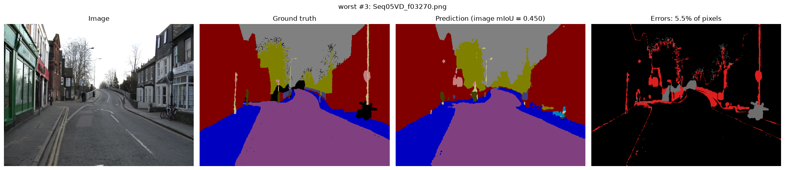
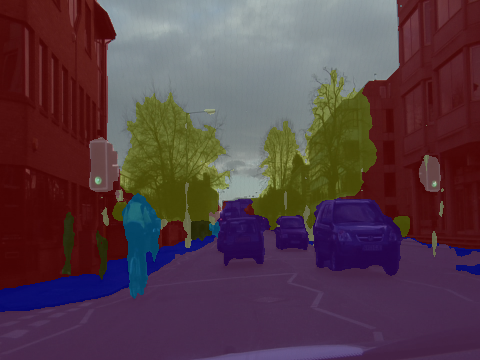

# SegFormer на CamVid — семантическая сегментация трансформером

Дообучение компактного трансформера **SegFormer-B0** (3.7 млн параметров) на датасете
**CamVid** и сравнение с ранее обученной свёрточной моделью **DeepLabV3-ResNet50**
(39.6 млн) на той же выборке. Переход от ViT-классификации к попиксельному предсказанию.

Материалы: [статья SegFormer](https://arxiv.org/abs/2105.15203) ·
[туториал HuggingFace по сегментации](https://huggingface.co/docs/transformers/tasks/semantic_segmentation)

**Итог:** при одинаковом входе 360×480 и одинаковом бюджете (50 эпох) SegFormer-B0,
предобученный на Cityscapes, идёт вровень с DeepLabV3-ResNet50 при в 11 раз меньшем
числе параметров: **test mIoU 0.691 против 0.695** (0.701 с flip-TTA). С увеличенным
входом 512×683 B0 его обходит (0.713), но получает примерно вдвое больше пикселей.
Базовая модель по туториалу HuggingFace (ImageNet-энкодер) даёт 0.636.

---

## 1. Что предлагают авторы SegFormer

SegFormer объединяет иерархический трансформерный энкодер с предельно простым
декодером из MLP-слоёв. Вся «тяжесть» вынесена в энкодер, а декодер намеренно
облегчён — за счёт этого модель одновременно точная, быстрая и устойчивая к
смене разрешения. Три ключевые идеи:

### Иерархический энкодер (Mix Transformer, MiT)

Обычный ViT делит изображение на патчи 16×16 один раз и дальше работает на одном
низком разрешении. Энкодер SegFormer устроен в **4 стадии**: после каждой карта
признаков уменьшается по высоте/ширине, но углубляется по каналам — как в
свёрточных сетях (у B0: 32 → 64 → 160 → 256 каналов). Отличия от ViT:

- **Перекрывающиеся патчи** (overlapping patch merging): эмбеддинг патчей — это свёртка
  7×7 со stride 4 на первой стадии и 3×3 со stride 2 на остальных. Окна перекрываются,
  поэтому сохраняется непрерывность на границах патчей.
- **Mix-FFN вместо позиционного кодирования** — информацию о положении даёт
  depthwise-свёртка 3×3 внутри FFN. Поэтому модель не теряет точность, когда разрешение на
  тесте отличается от обучающего (у ViT с фиксированным PE здесь просадка). В этом проекте
  этим пользуемся напрямую: обучение на кропах 360×360, инференс на полном кадре 360×480.
- **Efficient self-attention**: ключи и значения сжимаются свёрткой со stride R
  (у B0 по стадиям 8, 4, 2, 1), и сложность внимания падает с O(N²) до O(N²/R²).
  Например, на первой стадии для входа 360×480 это 10 800 запросов (90×120) × 165 ключей (11×15)
  вместо 10 800 × 10 800 — при этом каждый пиксель по-прежнему видит всю картинку.

### Признаки нескольких масштабов (multi-scale)

Благодаря 4 стадиям энкодер выдаёт карты признаков разрешением **1/4, 1/8, 1/16,
1/32** от входа. Мелкомасштабные (1/4) хранят тонкие детали и границы
объектов, крупномасштабные (1/32) — общий контекст сцены. Для сегментации нужно
и то, и другое одновременно, а не одна карта, как у ViT.

### Лёгкий декодер (All-MLP)

Декодер собирает четыре карты в маску за 4 простых шага: каждый уровень
прогоняется через линейный слой (уравнивание каналов до 256) → всё апсэмплится до 1/4 и
конкатенируется → линейный слой сливает → финальный слой выдаёт класс на пиксель.
Никаких ASPP и тяжёлых модулей. Это работает потому, что трансформерный энкодер
уже даёт большое эффективное рецептивное поле, совмещая локальное и глобальное
внимание. Декодер занимает ~4 % параметров даже у самой большой модели.

Важное следствие: **выход модели имеет разрешение 1/4 от входа**, и до размера кадра
он восстанавливается билинейной интерполяцией.

Серия моделей — от **B0** (3.7 млн параметров, для реального времени) до **B5**
(лучшее качество). В этом проекте используется компактная **B0**.

---

## 2. Структура репозитория

```
SegFormer-CamVid/
├── README.md
├── requirements.txt
├── config.py            # пути, гиперпараметры, выбор конфигурации (EXP)
├── camvid_dataset.py    # загрузка CamVid, конвертация цветных масок в индексы, аугментации
├── train.py             # дообучение SegFormer-B0 (HuggingFace Trainer), CE + Lovász, mIoU на val
├── evaluate_model.py    # mIoU на val/test в исходном разрешении, IoU по классам, лучшие/худшие кадры
├── predict.py           # инференс на одном изображении + оверлей маски
├── sanity_check.py      # проверка обработки картинок/масок и восстановления размера
├── perf_models.py       # профилирование: загрузка SegFormer и DeepLabV3, режимы точности, замеры
├── benchmark.py         # сводная таблица скорости, памяти и mIoU -> results/perf/
├── profile_models.py    # PyTorch Profiler, разбивка по операциям и частям модели -> results/profile/
├── REPORT_profiling.md  # отчёт о профилировании SegFormer-B0 и DeepLabV3
├── tests/
│   └── test_mask_mapping.py   # синтетический тест конвертации масок (numpy, без torch)
├── weights/
│   └── segformer-b0-camvid/   # веса итоговой модели (config + safetensors + processor)
├── results/             # metrics*.json, train_log.json, примеры предсказаний, perf/, profile/
├── logs/                # логи обучения, оценки и sanity_check
└── outputs/             # не в git: рабочие папки обучения с чекпоинтами
```

---

## 3. Данные (CamVid)

Используется CamVid из [CamVid-for-Segmentation](https://github.com/stonewst/CamVid-for-Segmentation),
путь задаётся в `config.py` → `DATA_ROOT`:

```
CamVid/
├── class_palette.csv       # name,r,g,b — цвет каждого из 12 классов (11 + unlabelled)
├── train/  trainannot/     # 367 кадров
├── val/    valannot/       # 101 кадр
└── test/   testannot/      # 233 кадра
```

Картинка — `<stem>.png` (480×360), маска — `<stem>_L.png` (**RGB-изображение**, цвет
кодирует класс). Разбиение 367 / 101 / 233 и 11 классов — те же, что у свёрточной
модели DeepLabV3-ResNet50.

**Маски.** Модель ждёт индексы классов, а маски цветные. `camvid_dataset.py` читает
`class_palette.csv` и переводит RGB-маску в карту индексов 0…10. Класс `unlabelled`
помечается как `255` и игнорируется и в loss, и в mIoU. Если маски уже в индексном
формате (grayscale) — поставь `MASK_MODE = "index"`.

---

## 4. Конвейер обработки

**Обучение** (`CamVidDataset`, `train=True`):
1. Случайный масштаб 0.5–2.0 от короткой стороны 360 → случайный кроп 360×360.
   Картинка ресайзится билинейно, маска — **nearest** (индексы классов нельзя интерполировать).
   Если кадр меньше кропа, паддинг маски заполняется `255`, чтобы не учить модель на рамке.
2. `ColorJitter` (яркость, контраст, насыщенность, оттенок) и горизонтальное отражение.
3. `SegformerImageProcessor`: только `/255` и нормализация mean/std ImageNet (без ресайза).

**Оценка** (val/test): картинка подаётся в исходном размере **360×480**, как у DeepLabV3;
маска не ресайзится.

**Модель → маска**: логиты 11 × H/4 × W/4 → билинейный апсэмпл до 360×480 → `argmax`.

### Проверка (`sanity_check.py`)

Вывод на первом кадре train (полностью — `logs/sanity_check.txt`):

| Этап | Результат |
|---|---|
| палитра | 12 строк, 11 обучаемых классов, `unlabelled` → 255 |
| исходная картинка / маска | 360×480 (H×W), маска RGB |
| маска → индексы | 10 цветов, все есть в палитре; `unlabelled` — 4.62 % пикселей кадра |
| train-сэмпл (scale + crop) | `pixel_values` 3×360×360, `labels` 360×360, набор классов не испорчен |
| eval-сэмпл | `pixel_values` 3×360×480 float32, `labels` 360×480 int64 |
| логиты модели | 11×90×120 — **1/4 от входа**, не полный размер |
| после `interpolate(bilinear)` | 360×480 = размер исходного кадра (`assert` пройден) |

Тест `tests/test_mask_mapping.py` проверяет нумерацию классов, `unlabelled → 255`,
неизвестный цвет → 255 и обратную раскраску.

---

## 5. Обучение

Три конфигурации, выбираются переменной окружения `EXP`; у всех 50 эпох, batch 4
(92 шага на эпоху) — тот же бюджет, что у DeepLabV3.

| | `old` — базовая | `main` — итоговая | `hires` — увеличенный вход |
|---|---|---|---|
| Предобучение | `nvidia/mit-b0` (ImageNet), голова случайная | `nvidia/segformer-b0-finetuned-cityscapes-1024-1024` | как `main` |
| Голова | новая | классификатор 1×1 из строк соответствующих классов Cityscapes (`road → Road`, `vegetation → Tree`, `rider → Bicyclist`, …, см. `HEAD_INIT_FROM`) | как `main` |
| Вход train / eval | растяжение в 512×512 / 512×512 | scale-crop 360 / **360×480** | scale-crop 512 / 512×683 |
| Loss | Cross-Entropy | CE + Lovász-Softmax | как `main` |
| LR | 6e-5 для всей модели, без warmup | 6e-5 энкодер / 6e-4 голова, warmup 300 шагов | как `main` |
| Общее | AdamW, weight decay 0.01 (кроме bias и norm), линейный спад LR до 0, fp16, ColorJitter + отражение; веса — чекпоинт с лучшим mIoU на val | | |
| Папка | `outputs/b0_mitb0_old` | `outputs/b0_cityscapes_360_e50` | `outputs/b0_cityscapes_512_e50` |

`old` — исходный вариант проекта, сделанный по туториалу HuggingFace. `main` отличается
от него тремя вещами:
- **Инициализация из Cityscapes** — тот же домен (городские улицы) и почти те же классы;
  поэтому модель не учит голову с нуля, и уже после первой эпохи val mIoU 0.68 (у `old` — 0.37).
- **Вход без искажения пропорций и scale-crop**: тонкие вертикальные объекты (столбы,
  знаки) не сплющиваются, модель видит объекты в разных масштабах.
- **Lovász-Softmax** напрямую оптимизирует IoU и даёт мелким классам тот же вес, что и
  дороге; CE даёт стабильные градиенты на старте.

### Динамика обучения

- `main` (`logs/b0_cityscapes_360_e50.log`, 9 мин на RTX 3050): val mIoU 0.677 после
  1-й эпохи → 0.744 на 5-й → 0.756 на 20-й → лучшая эпоха 29 (0.773) → 0.768 на 50-й.
  Минимум val loss тоже на 29-й эпохе (0.405); дальше train loss падает (0.44 → 0.40),
  а val loss растёт до 0.43 — лёгкое переобучение, на mIoU почти не сказывается.
- `old` (`logs/b0_mitb0_old.log`): 0.37 → 0.70 к 20-й эпохе, плато ~0.72 с 30-й.
- 50 эпох достаточно: лучшая эпоха — 29-я, а ранее проверенные варианты `main` с
  входом 512×683 дали на test 0.702 (25 эпох), 0.713 (50) и 0.709 (100 эпох).
- Значения loss у `old` (только CE) и остальных (CE + Lovász) не сравнимы — сравнивается mIoU.

---

## 6. Результаты

**Метрики считаются в исходном разрешении масок 360×480**: логиты апсэмплятся до
размера кадра и сравниваются с оригинальной маской без ресайза — так же, как у
DeepLabV3. mIoU — по всему сплиту (пересечения и объединения суммируются по всем кадрам),
а не среднее по кадрам. Эпоха выбирается по val, итоговая цифра — test.

| Модель | Параметры | Вход | mIoU val | mIoU test | Pixel acc. val / test |
|---|---|---|---|---|---|
| DeepLabV3-ResNet50, CE + Lovász (свёрточная) | 39.6 млн | 360×480 | 0.776 | **0.695** | 0.952 / — |
| SegFormer-B0 базовая (`old`) | 3.7 млн | 512×512 | 0.721 | 0.636 | 0.946 / 0.910 |
| **SegFormer-B0 итоговая (`main`)** | **3.7 млн** | **360×480** | **0.773** | **0.691** | 0.954 / 0.921 |
| ↳ + flip-TTA | | 360×480 | 0.780 | 0.701 | 0.957 / 0.925 |
| SegFormer-B0, увеличенный вход (`hires`) | 3.7 млн | 512×683 | 0.777 | 0.713 | 0.955 / 0.928 |

IoU по классам на test:

| Класс | DeepLabV3-R50 | B0 базовая | **B0 итоговая** |
|---|---|---|---|
| Road | 0.954 | 0.936 | **0.955** |
| Sky | 0.902 | 0.917 | **0.913** |
| Car | 0.897 | 0.816 | **0.866** |
| Building | 0.837 | 0.826 | **0.840** |
| Sidewalk | 0.847 | 0.788 | **0.852** |
| Tree | 0.761 | 0.773 | **0.772** |
| Pedestrian | 0.599 | 0.492 | **0.579** |
| Bicyclist | 0.684 | 0.493 | **0.600** |
| Fence | 0.395 | 0.358 | **0.446** |
| SignSymbol | 0.501 | 0.419 | **0.480** |
| Pole | 0.269 | 0.179 | **0.299** |
| **mIoU** | **0.695** | **0.636** | **0.691** |

### Выводы

- **При равных условиях SegFormer-B0 идёт вровень с DeepLabV3-ResNet50**: тот же вход
  360×480, те же 50 эпох, mIoU 0.691 против 0.695 на test и 0.773 против 0.776 на val —
  при в 11 раз меньшем числе параметров. По классам: B0 лучше на заборах (+0.05),
  столбах (+0.03), небе и деревьях (+0.01), хуже на велосипедистах (−0.08), машинах
  (−0.03), пешеходах и знаках (−0.02); дорога, тротуар и здания — наравне.
- **Улучшение базовой модели (+0.055 на test) в основном даёт предобучение в том же
  домене.** В отдельном прогоне с входом 512×683 замена Cityscapes-инициализации на
  ImageNet при прочих равных снижала test mIoU с 0.709 до 0.660. Это нужно учитывать при
  сравнении: DeepLabV3 предобучен на COCO/VOC, а не на уличных сценах.
- **Разрешение входа важно для B0.** Выход SegFormer — 1/4 от входа: при 360×480 это
  карта 90×120, одна клетка на 4×4 пикселя кадра. С входом 512×683 (`hires`) test mIoU
  0.713 — выше DeepLabV3, — сильнее всего растут заборы (+0.11), знаки (+0.04), машины,
  столбы и здания (+0.02…0.03); цена — вдвое больше пикселей на инференсе.
- **`Bicyclist` — самый заметный проигрыш B0** (0.600 против 0.684). В CamVid
  велосипедист размечен целиком (человек + велосипед), класс редкий и определяется
  контекстом; типичная ошибка — верх фигуры уходит в `Pedestrian`.
- **Разрыв val → test (0.773 → 0.691) сосредоточен в редких классах**: Fence
  0.74 → 0.45, Bicyclist 0.84 → 0.60, Tree 0.92 → 0.77; на дороге, небе и машинах разница
  почти нулевая. Кадры val сняты на тех же видеопоследовательностях, что часть train,
  test — на других. Такой же разрыв у DeepLabV3 (0.776 → 0.695). Исключение — `Pole`:
  0.16 на val и 0.30 на test, то есть дело в самих кадрах val.
- **Столбы — самый трудный класс** (0.30): столб шириной 1–3 пикселя меньше одной клетки
  выходной карты, и билинейный апсэмпл не восстанавливает его форму.
- **Flip-TTA** (усреднение логитов с предсказанием по отражённому кадру) даёт +0.01 на
  test (0.701) ценой двойного времени инференса, для `hires` — +0.02 (0.732).

### Примеры предсказаний

Панели: кадр | эталон | предсказание | карта ошибок (красный — неверные пиксели,
серый — `unlabelled`). Кадры отобраны по mIoU кадра, усреднённому по классам,
присутствующим на кадре (итоговая модель, без TTA).

**Успешные**





- `best_1` (0001TP_008580, mIoU кадра 0.78, ошибки 6.2 %): тёмный пасмурный кадр, тем
  не менее велосипедист в центре выделен целиком и правильным классом, машины и деревья —
  с точными контурами. Ошибки — края крон на фоне неба и тротуар у правого края.
- `best_2` (0001TP_008880, 0.76, 7.7 %): велосипедист у левого края, обрезанный кадром,
  распознан; машина впереди выделена точно. Ошибки — граница деревьев и зданий, далёкие
  пешеходы у обочины.
- `best_3` (Seq05VD_f02430, 0.75, 7.2 %): найдены почти все столбы, светофор и знаки;
  ошибки — толщина столбов, дальние здания, бордюр.

**Ошибочные**





- `worst_1` (Seq05VD_f02610, mIoU кадра 0.18, ошибки 46 %): предсказание соответствует
  кадру, а эталон — нет: тротуар справа обрезан прямой вертикальной границей, контуры
  дороги и тротуара слева не совпадают с видимой геометрией. Кадр снят почти с той же
  точки, что `best_3`, где эталон совпадает с картинкой, — это ошибка разметки, а не модели.
- `worst_2` (Seq05VD_f03870, 0.44, 5.2 %): почти все пиксели верны; низкий mIoU даёт
  крошечный далёкий велосипедист (несколько пикселей), которого модель не нашла, и
  ложные мелкие объекты в конце улицы, а также шумная разметка у нижнего края кадра.
  Так как mIoU кадра усредняется по присутствующим классам, один неверный мелкий объект
  весит столько же, сколько вся дорога.
- `worst_3` (Seq05VD_f03270, 0.45, 5.5 %): ошибки на мелких объектах — пропущен знак на
  правом столбе, ложный знак на здании слева, далёкие пешеходы; припаркованные велосипеды
  справа в эталоне размечены как `unlabelled` и в метрику не входят.
- Типичные ошибки в целом: тротуар ↔ дорога у бордюров, пропуск или утолщение столбов,
  вывески и заборы ↔ здания, `Bicyclist` ↔ `Pedestrian`.

---

## 7. Запуск

Окружения, на которых получены результаты:
- `main` и `hires`: Python 3.14, torch 2.14.1, transformers 5.22.1, evaluate 0.4.6,
  segmentation-models-pytorch 0.5.0, NVIDIA GeForce RTX 3050;
- `old`: Python 3.8, torch 2.4.1, transformers 4.46.3, evaluate 0.4.6,
  segmentation-models-pytorch 0.3.3, NVIDIA GeForce RTX 4050.

```bash
pip install -r requirements.txt
# в config.py указать DATA_ROOT — путь к папке CamVid

# 1. проверка препроцессинга (до обучения)
python3 tests/test_mask_mapping.py
python3 sanity_check.py | tee logs/sanity_check.txt

# 2. дообучение итоговой модели (~10 мин)
python3 train.py 2>&1 | tee logs/b0_cityscapes_360_e50.log

# 3. оценка на val и test в исходном разрешении 360×480
#    -> outputs/b0_cityscapes_360_e50/metrics.json и predictions/best_*.png, worst_*.png
python3 evaluate_model.py | tee logs/evaluate.txt
python3 evaluate_model.py --flip | tee logs/evaluate_flip.txt   # flip-TTA -> metrics_flip.json

# 4. сравнительные конфигурации
EXP=old python3 train.py 2>&1 | tee logs/b0_mitb0_old.log
EXP=old python3 evaluate_model.py | tee logs/evaluate_old.txt
EXP=hires python3 train.py 2>&1 | tee logs/b0_cityscapes_512_e50.log
EXP=hires python3 evaluate_model.py | tee logs/evaluate_hires.txt

# 5. предсказание на одной картинке готовыми весами
python3 predict.py <DATA_ROOT>/test/0001TP_008550.png pred.png --model weights/segformer-b0-camvid
```

`evaluate_model.py` (позиционный аргумент) и `predict.py` (`--model`) принимают путь к любой
папке с весами или к чекпоинту; по умолчанию — `outputs/<RUN_NAME>` текущей конфигурации.
Флаг `--flip` включает flip-TTA в обоих скриптах.

Пример результата `predict.py` (оверлей предсказания на кадре test `0001TP_008550`):



---

## 8. Профилирование

Подробный отчёт — **[REPORT_profiling.md](REPORT_profiling.md)**: задержка, пропускная
способность, память и узкие места обеих моделей в режимах fp32 / tf32 / fp16 / bf16 / half /
`torch.compile`, профиль по операциям и по частям модели.

Главное (RTX 3050, вход 360×480, batch 1):

| | SegFormer-B0 | DeepLabV3-ResNet50 |
|---|---|---|
| mIoU test | 0.691 | 0.695 |
| GMACs | 4.9 | 107.8 |
| Задержка fp32 | 7.3 мс | 38.2 мс |
| Задержка, лучший режим (`fp16+compile`) | 3.4 мс | 15.8 мс |
| Память (веса + активации), fp32 | 112 МБ | 228 МБ |
| Узкое место | декодер и операции с памятью; в fp16 — запуск ядер | свёртки layer4 и ASPP |

SegFormer-B0 в 5 раз быстрее при практически той же точности. `autocast` его не ускоряет
(GPU простаивает в ожидании запуска коротких ядер), а `torch.compile` с CUDA Graphs ускоряет
в 2.1 раза. Смена точности не меняет mIoU ни у одной модели.

Главный кандидат на прунинг трансформера — ширина декодера: одна свёртка 1×1 `linear_fuse` даёт
57 % MACs модели. Следующий — внутренние каналы Mix-FFN (43 % параметров). Головы внимания можно
удалять только целиком (`head_dim` = 32 фиксирован), а в stage1 голова одна. Ширина
residual-потока связана со всеми слоями стадии. Подробности и план экспериментов — в разделах
6–7 отчёта.

---

## 9. Результат работы

- **Код** дообучения (`train.py`) и инференса/оценки (`evaluate_model.py`, `predict.py`).
- **Веса** итоговой модели (`EXP=main`, лучший чекпоинт, эпоха 29) — в репозитории,
  `weights/segformer-b0-camvid/` (`config.json`, `model.safetensors` 15 МБ,
  `preprocessor_config.json`). Загрузка:
  ```python
  from transformers import AutoImageProcessor, AutoModelForSemanticSegmentation
  processor = AutoImageProcessor.from_pretrained("weights/segformer-b0-camvid")
  model = AutoModelForSemanticSegmentation.from_pretrained("weights/segformer-b0-camvid")
  ```
- **Показатели** — `results/metrics.json` и `results/metrics_flip.json` (итоговая модель:
  mIoU, accuracy, IoU по классам для val и test), `results/train_log.json` (история
  обучения), `results/metrics_old.json`, `results/metrics_hires*.json` (сравнительные
  конфигурации), логи в `logs/`, примеры в `results/predictions/`.
- **Профилирование** — [PROFILING.md](PROFILING.md), таблицы в `results/perf/`,
  профили в `results/profile/*/summary.md`.
