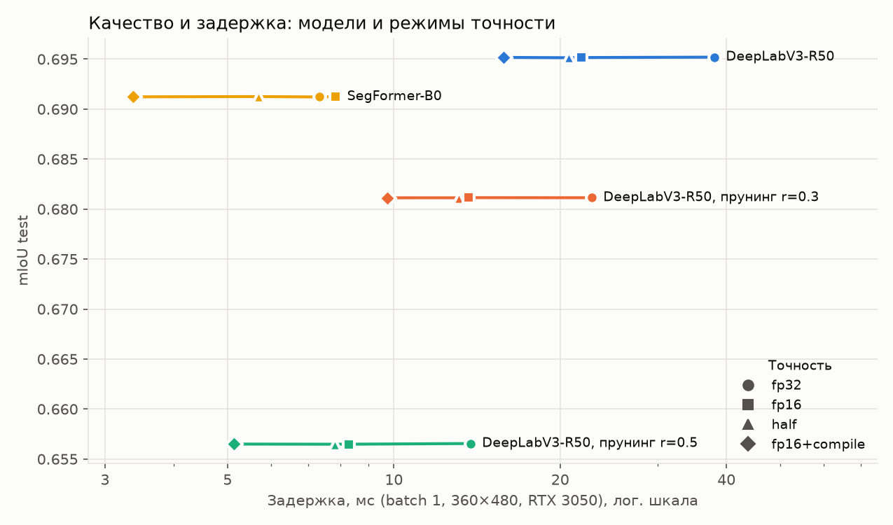

# Отчёт: от свёрточных сетей к трансформерам в семантической сегментации

**Цель.** Освоить устройство свёрточных и трансформерных моделей компьютерного зрения,
научиться адаптировать их под новые данные и провести первые эксперименты по оптимизации.

**Коротко.**
- Трансформер **SegFormer-B0** почти догоняет по качеству свёрточную **DeepLabV3-ResNet50**:
  0.691 против 0.695 mIoU на test. При этом у SegFormer в 10.7 раза меньше параметров, в 22 раза
  меньше вычислений, и он в 5.2 раза быстрее в fp32.
- Самая эффективная оптимизация без потери качества — `torch.compile` с CUDA Graphs и fp16:
  ×2.2 для SegFormer (3.4 мс на кадр) и ×2.4 для DeepLabV3.
- Структурный прунинг DeepLabV3 (DepGraph) даёт ×1.7–2.8 ценой −0.014…−0.039 mIoU. Вместе с
  пониженной точностью получается ×3.9–7.4. Но и при этом трансформер выигрывает и по скорости,
  и по качеству.

Навигация по коду и подзадачам — [README.md](README.md), конспекты статей — [papers/](papers/README.md).

---

## 1. Постановка и условия

| | |
|---|---|
| Датасет | CamVid, 11 классов + `unlabelled` (игнорируется), кадры 360×480 ([data/README.md](data/README.md)) |
| Разбиение | фиксированное: 367 train / 101 val / 233 test; эпоха выбирается по val, итог — test |
| Метрика качества | mIoU по всему сплиту в исходном разрешении 360×480 |
| Оборудование | NVIDIA GeForce RTX 3050 8 ГБ; Python 3.14, torch 2.14.1 + CUDA 13.0 |
| Протокол замера скорости | batch 1, вход 360×480, 30 прогревочных + 200 замеренных проходов, CUDA events и `synchronize` на каждой итерации, медиана и p90 |
| Память | веса + пиковый прирост `memory_allocated` за проход |

Все модели в сводной таблице (раздел 3) измерены одним скриптом в одном сеансе.

## 2. Ход работы

Подзадачи идут от простого к сложному. Каждая следующая опирается на результат предыдущей.

### Свёрточные модели

**1. FCN** ([конспект](papers/01_fcn.md), [отчёт](01_fcn/README.md)). Разобрана идея полностью
свёрточной сети: свёртка 1×1 как классификатор пикселей, уменьшение разрешения с шагом 32,
восстановление размера транспонированной свёрткой и skip-связи. Реализованы FCN и FCN-skip.
Для двух размеров входа выход имеет форму `[B, 21, H, W]` и совпадает по размеру со входом.
Проверено, что skip-ветвь с нулевой инициализацией не меняет выход до обучения, но получает
ненулевой градиент и начинает учиться с первого шага.

**2. U-Net** ([конспект](papers/02_unet.md), [отчёт](02_unet/README.md)). Главное отличие от FCN:
по связям передаются полные карты признаков (конкатенация на 4 уровнях), а не оценки классов.
Компактная U-Net (482 тыс. параметров) переобучена на нескольких изображениях: IoU на train 0.999.
Контрольный опыт с перемешанными масками показал, что сеть выучила связь изображения и разметки:
на новых данных IoU 0.874 против 0.132.

**3. Дообучение готовой модели** ([конспект](papers/03_fine_tuning.md),
[отчёт](03-04_deeplab_finetune_pruning/reports/REPORT_Fine-Tuning.md)). DeepLabV3-ResNet50
(веса COCO/VOC) адаптирована под 11 классов CamVid. Маски и совместные геометрические
аугментации проверены. При одинаковом бюджете (50 эпох):

| Что обучается | mIoU val | mIoU test |
|---|---|---|
| только выходной слой | 0.409 | 0.404 |
| голова DeepLabHead с нуля, энкодер заморожен | 0.703 | 0.596 |
| вся модель (CE) | 0.766 | 0.685 |
| **вся модель (CE + Lovász) — итоговая** | **0.776** | **0.695** |

Одного выходного слоя недостаточно: в VOC дорога, небо, тротуар, столбы и знаки были одним
классом «фон», и замороженные признаки их не различают. Итоговая модель служит базой для
подзадач 4 и 8.

**4. Структурный прунинг** ([конспект](papers/04_depgraph.md),
[отчёт](03-04_deeplab_finetune_pruning/reports/REPORT_Pruning.md)). Показано, что обнуление весов
не ускоряет модель (38.7 мс против 38.2), а физическое удаление каналов ускоряет (13.9 мс).
DepGraph делит DeepLabV3 на 44 группы связанных слоёв. Канал на выходе residual-блока затрагивает
12 слоёв. Получены две модели с 11 выходами: r = 0.3 и r = 0.5. Сразу после прунинга mIoU падает
до 0.07, после 15 эпох дообучения (3–4 мин) он восстанавливается до 0.681 и 0.657.

### Трансформерные модели

**5. Encoder трансформера** ([конспект](papers/05_transformer.md),
[отчёт](05-06_transformer_vit/report/transformer_encoder.md)). Реализован scaled dot-product
attention: он совпадает с `F.scaled_dot_product_attention` до 2.4·10⁻⁷. Собран encoder-блок:
multi-head attention, FFN, residual и LayerNorm. Подсчёт FLOPs, сверенный с `FlopCounterMode`,
показывает, что при d = 512 внимание дороже линейных слоёв начиная с T = 3072 токенов, а при
T = 8192 даёт 73 % вычислений.

**6. Vision Transformer** ([конспект](papers/06_vit.md), [отчёт](05-06_transformer_vit/report/vit.md)).
Реализованы нарезка изображения на патчи и patch embedding. Собран учебный ViT на блоке из
подзадачи 5. Разобраны модули предобученного ViT-B/16 и его предсказание. По таблице числа токенов
видно, почему ViT в чистом виде плохо подходит для сегментации: одна грубая сетка 1/16 и
квадратичный рост стоимости с разрешением.

**7. SegFormer** ([конспект](papers/07_segformer.md), [отчёт](07-08_segformer_profiling/README.md)).
SegFormer устраняет эти проблемы: иерархический энкодер (1/4…1/32), сжатие K/V в attention,
Mix-FFN вместо позиционных эмбеддингов и лёгкий MLP-декодер. SegFormer-B0 (Cityscapes) дообучена
на том же CamVid и даёт **0.691 mIoU test** (0.701 с flip-TTA). Базовый вариант из туториала
HuggingFace с энкодером ImageNet даёт лишь 0.636. Основной вклад даёт предобучение на том же
домене: при прочих равных замена Cityscapes на ImageNet снижает test mIoU с 0.709 до 0.660.
Разрешение тоже важно: выход SegFormer имеет размер 1/4 от входа, и на 512×683 B0 достигает
0.713 — выше, чем DeepLabV3.

**8. Профилирование и оптимизация** ([конспект](papers/08_profiler.md),
[отчёт](07-08_segformer_profiling/PROFILING.md)). PyTorch Profiler показал, что модели упираются
в разное:
- DeepLabV3 **ограничен вычислениями**: свёртки занимают 73 % времени, GPU загружен на 100 %;
- SegFormer-B0 **ограничен памятью и запуском ядер**: 48 % GPU-времени — операции с памятью, в
  fp16 GPU 30 % времени ждёт CPU.

Поэтому одна и та же оптимизация действует на них по-разному (раздел 4).

## 3. Сводная таблица моделей

Основные варианты. Полная таблица всех режимов точности — в [README.md](README.md#сводная-таблица-моделей)
и [results/summary_table.csv](results/summary_table.csv).

| Модель | Вариант | mIoU test | Задержка, мс | Ускорение | Память, МБ | Параметры, млн | GMACs |
|---|---|---|---|---|---|---|---|
| DeepLabV3-R50 | fp32 | 0.695 | 38.0 | ×1.00 | 228 | 39.6 | 107.8 |
| DeepLabV3-R50 | fp16+compile | 0.695 | 15.8 | ×2.40 | — | 39.6 | 107.8 |
| DeepLabV3-R50, r = 0.3, сразу после прунинга | fp32 | 0.076 | 22.9 | ×1.66 | 124 | 19.0 | 51.4 |
| DeepLabV3-R50, r = 0.3 + 15 эпох | fp32 | 0.681 | 22.8 | ×1.67 | 124 | 19.0 | 51.4 |
| DeepLabV3-R50, r = 0.3 + 15 эпох | fp16+compile | 0.681 | 9.7 | ×3.91 | — | 19.0 | 51.4 |
| DeepLabV3-R50, r = 0.5, сразу после прунинга | fp32 | 0.074 | 13.8 | ×2.76 | 75 | 9.9 | 27.1 |
| DeepLabV3-R50, r = 0.5 + 15 эпох | fp32 | 0.657 | 13.8 | ×2.76 | 75 | 9.9 | 27.1 |
| DeepLabV3-R50, r = 0.5 + 15 эпох | fp16+compile | 0.657 | 5.1 | ×7.41 | — | 9.9 | 27.1 |
| SegFormer-B0 | fp32 | 0.691 | 7.3 | ×1.00 | 112 | 3.7 | 4.9 |
| SegFormer-B0 | fp16 (autocast) | 0.691 | 7.8 | **×0.93** | 129 | 3.7 | 4.9 |
| SegFormer-B0 | half | 0.691 | 5.7 | ×1.29 | 57 | 3.7 | 4.9 |
| **SegFormer-B0** | **fp16+compile** | **0.691** | **3.4** | **×2.17** | — | 3.7 | 4.9 |

Ускорение считается к fp32 исходной модели той же архитектуры. Для `fp16+compile` память не
измеряется: буферы CUDA Graphs выделяются при захвате графа, до замера.



*Каждая линия — одна модель, точки — режимы точности. Чем левее и выше, тем лучше. Модели сразу
после прунинга (mIoU ≈ 0.07) не показаны.*

## 4. Что дала оптимизация

| Приём | DeepLabV3-R50 | SegFormer-B0 | Почему так |
|---|---|---|---|
| TF32 | ×1.00 | ×1.04 | свёртки cuDNN и так идут в TF32, matmul мало |
| `autocast` fp16 | ×1.74 | **×0.93** | у DeepLab свёртки переходят на тензорные ядра; у SegFormer приведения типов добавляют 1.6 мс копирований, число ядер растёт с 252 до 435 |
| `half` | ×1.83 | ×1.29 | нет приведений, но ядра SegFormer так коротки (17 мкс), что CPU не успевает их запускать |
| `fp16+compile` (CUDA Graphs) | ×2.40 | ×2.17 | весь проход запускается одной командой, поэлементные операции сливаются |
| Прунинг r = 0.3 / 0.5 | ×1.67 / ×2.76 | — | MACs −52 % / −75 %; задержка падает медленнее MACs |
| Прунинг + `fp16+compile` | ×3.91 / ×7.41 | — | приёмы складываются |

Наблюдения:
1. **Пониженная точность безопасна:** ни один режим не меняет mIoU больше чем на 0.0002.
2. **MACs не предсказывают задержку.** SegFormer в 22 раза меньше по MACs, но быстрее только
   в 5.2 раза. Прунинг уменьшает MACs в 4 раза, а время — в 2.8. Выбирать оптимизацию нужно по
   измерениям, а не по подсчёту операций.
3. **Отрицательный результат объяснён.** `autocast` замедляет SegFormer: время ядер падает
   (7.3 → 5.5 мс), но GPU простаивает в ожидании CPU. Помогает только устранение накладных
   расходов на запуск (CUDA Graphs).
4. **Прунинг ≠ выигрыш у трансформера.** Даже DeepLabV3 r = 0.5 в `fp16+compile` (5.1 мс,
   0.657) медленнее и хуже SegFormer-B0 в том же режиме (3.4 мс, 0.691).

## 5. Выводы

- Для сегментации CamVid на этом GPU лучший компромисс — **SegFormer-B0 в `fp16+compile`**:
  3.4 мс на кадр (~295 кадр/с при batch 1) и 0.691 mIoU, всего 3.7 млн параметров.
- Эффективность трансформера для пиксельных задач даёт не «внимание вообще», а инженерные
  решения SegFormer: иерархия масштабов, сжатие K/V, отказ от позиционных эмбеддингов, лёгкий
  декодер.
- Способ адаптации решает больше, чем выбор архитектуры: выбор, что именно дообучать, меняет
  mIoU DeepLabV3 с 0.40 до 0.69, предобучение SegFormer на близком домене даёт +0.05, а разница
  между архитектурами — 0.004.
- Структурный прунинг свёрточной модели работает предсказуемо и дёшево восстанавливается, но
  связи между слоями (residual-поток стадии) ограничивают, какие каналы можно удалять.

## 6. Ограничения работы

- **Один запуск на конфигурацию** (seed 42): разброс mIoU между сидами не оценивался. Разницу
  0.004 между SegFormer и DeepLabV3 нельзя считать значимой.
- **Подзадачи 1–2** выполнены на учебных данных: FCN — проверка размеров без обучения, U-Net —
  синтетические изображения. На CamVid обучались модели подзадач 3, 4 и 7.
- **Одна видеокарта** (RTX 3050). Абсолютные задержки переносимы на другое оборудование только
  как соотношения. Часть обучения подзадачи 3 шла на RTX 4050 Laptop, но все замеры скорости в
  отчёте сняты на RTX 3050.
- **Чекпоинты DeepLabV3** (40–160 МБ) не хранятся в git, они воспроизводятся скриптами. Веса
  SegFormer-B0 лежат в репозитории.
- **Прунинг SegFormer не выполнялся:** в подзадаче 8 обоснованы кандидаты и ограничения, но
  сокращение не проводилось.

## 7. Следующие эксперименты

Обоснованы измерениями из подзадачи 8:
1. **Прунинг ширины декодера SegFormer 256 → 128** с дообучением: −43 % MACs модели в части,
   занимающей треть времени. Мерить в `fp16+compile`, где видна чистая цена ядер.
2. **Прунинг внутренних каналов Mix-FFN** в stage3–4 с построением кривой «доля каналов — mIoU —
   задержка».
3. **Экспорт в TensorRT / ONNX Runtime с fp16** для слияния LayerNorm, GELU и поэлементных
   операций, которые дают почти половину GPU-времени SegFormer.
4. **SegFormer-B0 на входе 512×683** (mIoU 0.713) в `fp16+compile`: точнее при задержке около
   6 мс.
5. **Несколько сидов** для итоговых моделей, чтобы оценить значимость разницы в mIoU.

## 8. Воспроизведение

```bash
pip install -r requirements.txt
git clone https://github.com/stonewst/CamVid-for-Segmentation.git data/CamVid
# обучение и прунинг — команды в README подзадач 3–4 и 7
# сводная таблица и график:
python scripts/summary_table.py && python scripts/plot_tradeoff.py
```
